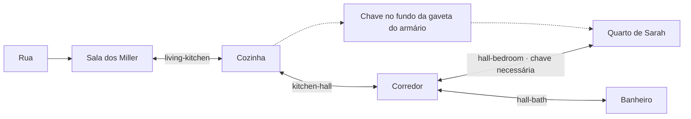

# NorthVale — arquitetura de interiores 0.4

O jogo carrega 15 manifestos JSON exclusivos para 15 construções do mapa. São 42 cômodos, 27 portas internas, 260 objetos definidos individualmente e 2.746 detalhes de ambientação. O antigo arranjo único de cinco móveis foi removido do runtime. A recepção ilustrada da delegacia foi preservada como um cômodo; gabinete, arquivo, interrogatório e celas são cenas 2.5D procedurais conectadas a ela.

As plantas, dimensões, materiais, nomes, textos e ações são dados autorais. A geração determinística cuida apenas de papéis, poeira, utensílios e desgaste; ela não escolhe a planta ou bloqueia o caminho com móveis aleatórios. Calendários, listas telefônicas e calculadoras têm limites por cômodo para evitar repetição visual. Estantes recebem livros nas faces e alturas apropriadas. A casa dos Miller usa desgaste, pôsteres e esconderijos; Ruth usa nogueira, carvalho, relatórios alinhados e acabamento limpo; Elias tem uma casa menor com livros médicos e cobranças.

## Classes e responsabilidades

| Classe / módulo | Função |
|---|---|
| `InteriorManifestLoader` | Carrega e valida os JSONs, IDs, dimensões, portas e conectividade. Um arquivo ausente produz erro; não há interior genérico de substituição. |
| `InteriorWorld` | Mantém o cômodo atual, colisões, A*, aproximação por clique, interações e transição com fade. |
| `InternalDoor` | Resolve o estado compartilhado entre os dois lados, chave, trinco interno, fechamento e tranca. |
| `InteriorRoomRenderer` | Enquadra cada cômodo, desenha paredes em corte com vãos, ordena móveis/atores, aplica luz e chuva nas janelas. |
| `RoomPropPainter` | Desenha móveis e objetos de 1989, variantes de gavetas abertas e cache LRU de 24 MiB. |
| `dressRoom` | Distribui microdetalhes a partir do estilo e dos móveis daquele cômodo, sem colisores adicionais. |
| `SaveSystem` | Registra estados por identidade global e grava/carrega o slot existente do jogo. |

Os arquivos estão em `src/interiors/`. Os manifestos completos estão em `assets/interiors/`.

## Planta da casa de Sarah



Na delegacia, a recepção liga gabinete e arquivo. O gabinete dá acesso ao interrogatório; o arquivo leva às celas. O arquivo exige o crachá, e as chaves das celas ficam numa gaveta do gabinete. As outras construções possuem seus próprios percursos: estoque e escritório da farmácia; leitura e microfilmes; recepção, quarto 17 e lavanderia; atendimento, escrituras e gabinete de Clara; processamento, câmara fria e escritório de Viktor.

## Manifestos de exemplo

Os exemplos solicitados são `assets/interiors/sarah.json` e `assets/interiors/police.json`. Cada manifesto possui `entranceRoom`, `exit`, `rooms[]` e `doors[]`.

Uma porta da casa de Sarah:

```json
{
  "id": "hall-bedroom",
  "name": "Quarto de Sarah",
  "a": {"room": "hall", "side": "east", "offset": 165, "width": 76},
  "b": {"room": "bedroom", "side": "west", "offset": 215, "width": 76},
  "isOpen": false,
  "isLocked": true,
  "requiresKey": "Chave do quarto de Sarah",
  "latchFrom": "bedroom"
}
```

`side` define o vão na parede local do cômodo; `offset` é a posição ao longo dela. Os portais na recepção pintada usam `side: "marker"`, âncora e aproximação calibradas para a ilustração. Os dois lados da porta consultam o mesmo ID persistente. `requiresKey` não consome a chave. `latchFrom` permite soltar o trinco do lado de dentro.

Cada cômodo tem `bounds`, `spawn`, `finish`, `ambient`, `lights`, `props` e `dressing`. Os props podem especificar `parentId` e `baseZ` para itens sobre móveis, `action`, `evidence`, `givesKey` e `range`. IDs locais não mudam quando posição ou texto são alterados.

## Transição, colisão e oclusão

Ao clicar em uma porta ou objeto, o Canvas faz picking no volume projetado. Itens elevados têm prioridade sobre seus móveis de apoio. Alex encontra uma aproximação por A* em uma matriz de 16 unidades, respeitando móveis sólidos e portas fechadas. Se já estiver próximo, E ou o clique executa a interação imediatamente.

A porta verifica a chave antes de modificar o estado. A transição dura 0,36 segundo: escurece, troca o cômodo no ponto médio e posiciona o jogador na aproximação do portal de destino. A câmera recalcula o enquadramento para as dimensões desse cômodo. Paredes internas têm altura reduzida e ficam parcialmente transparentes durante o fade. Os botões de navegação ficam desativados até a transição terminar.

Os cômodos usam coordenadas locais e são mostrados individualmente, conectados por portais; não é uma planta inteira carregada num único plano contínuo. O jogador continua colidindo com as paredes e com a folha fechada. Fechar uma porta sobre o jogador é recusado. Só a sala da entrada possui saída para a rua.

## Luzes e sombras

Cada cômodo declara suas próprias fontes: tungstênio, fluorescente e lua. Um interruptor controla as fontes artificiais daquele cômodo; a luz da janela continua independente. Fluorescentes têm variação discreta e zumbido quando o som está ligado. A iluminação é composta com multiply/screen e pools recortados ao piso.

Cada móvel volumoso projeta uma sombra própria com deslocamento relativo à luz e `shadowBlur` proporcional à altura. Isso é iluminação 2.5D aproximada, sem GI ou sombras físicas completas. A recepção pintada conserva a iluminação composta de sua arte original. Os novos cômodos são procedurais; não substituem a pintura por novas ilustrações pré-renderizadas.

## Persistência e compatibilidade

O save mantém o slot `northvale-save` e acrescenta:

```json
{
  "interior": "sarah",
  "interiorRoom": "bedroom",
  "interiorStates": {
    "northvale:sarah:kitchen:pantry": {"searched": true, "isOpen": true, "interactions": 1},
    "northvale:sarah:doors:hall-bedroom": {"isOpen": false, "isLocked": true, "interactions": 3},
    "northvale:sarah:bedroom:light-ceiling": {"isOn": false}
  }
}
```

Interações e mudanças de cômodo criam checkpoints automáticos quando o armazenamento está disponível. O botão **Salvar** continua disponível. Uma gaveta de Sarah nunca usa o estado de uma gaveta de Ruth, mesmo com IDs locais iguais. O save guarda deltas; os defaults continuam no JSON. As cinco provas anteriores mantêm seus IDs e não são duplicadas ao reexaminar objetos.

Saves anteriores continuam válidos e recebem os novos campos vazios. Se não há cômodo salvo, a entrada do prédio é usada; posições bloqueadas são corrigidas para piso livre. Provas, inventário, decisões e registros anteriores permanecem no slot. Dados de estado inválidos são recusados durante a carga.

## Editar e executar

Edite os JSONs de `assets/interiors/` para alterar plantas e histórias. `scripts/build-interior-manifests.mjs` registra as plantas autorais usadas para produzir a versão inicial. **`npm run interiors:author` reescreve esses JSONs**; use-o ao editar o script autoral e preserve alterações manuais antes de regenerar. O build comum lê os JSONs atuais e não os reescreve.

```sh
npm start
npm test
npm run check
npm run test:interiors
npm run build
```

`dist/NorthVale.html` incorpora os 15 manifestos e os PNGs da delegacia para uso sem rede. A execução normal busca os manifestos locais via HTTP. Não há serviço externo de conteúdo ou novas dependências.

No jogo, use **E** para interagir, clique para Alex se aproximar, **C** para fechar a porta próxima e **L** para trancar/destrancar. Os botões do painel inferior esquerdo indicam os aposentos adjacentes e suas trancas.

Os testes percorrem todos os alvos interativos dos 42 cômodos, verificam caminhos sem atravessar móveis, chaves, trincos, transições, IDs exclusivos, deltas de luz e ida/volta pelo SaveSystem. O smoke de navegador exercita o trajeto real até o quarto, picking do gravador sobre a mesa, coleta de prova, interruptor, checkpoints, recarga e passagem da recepção pintada ao gabinete.
